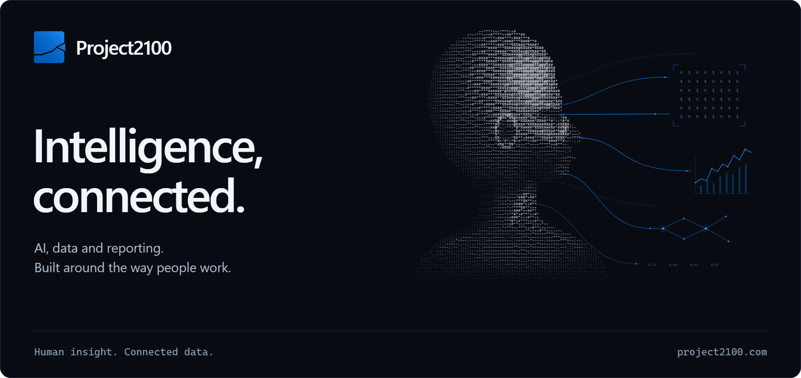

# AI and reporting, built around people.

We design, build and run data platforms, automated reporting and AI workflows for finance and operations teams.

By connecting the systems behind your business, we turn scattered information into reports, analysis and answers people can use.

### From source systems to better decisions

| Connected data | Automated reporting |
| :--- | :--- |
| Bring finance and operational systems into a shared reporting model. | Turn recurring management reports, board packs and commentary into repeatable workflows. |
| **Applied AI** | **Planning and analysis** |
| Put assistants and agents to work with your business data and processes. | Build forecasts, compare scenarios and understand the drivers behind performance. |

### Meet CoreIQ

A workspace for your reporting, data exploration and AI-assisted analysis. Ask questions in plain language and explore the figures behind the answer.

[Explore CoreIQ](https://www.project2100.com/coreiq)

---

**Less time preparing information. More time putting it to work.**

[Website](https://www.project2100.com/) &nbsp; · &nbsp; [Talk to an engineer](mailto:contact@project2100.com) &nbsp; · &nbsp; [LinkedIn](https://www.linkedin.com/company/project2100pty-ltd/)
