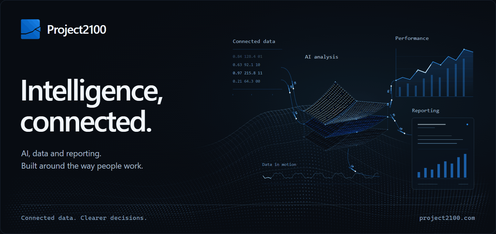
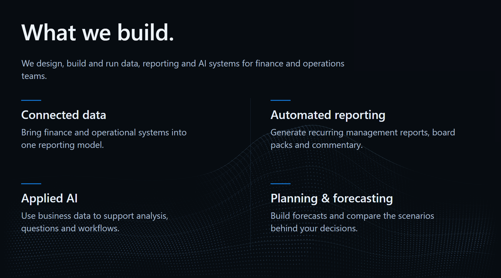
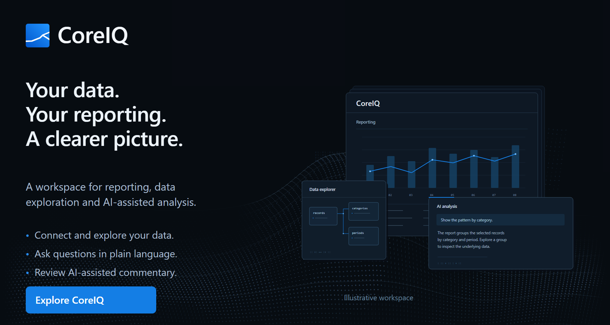
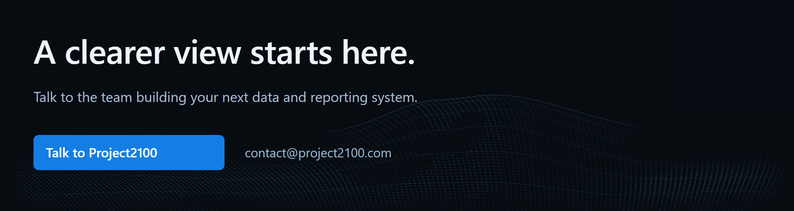

<a href="https://www.project2100.com/"><picture>
  <source media="(max-width: 600px) and (prefers-reduced-motion: reduce)" srcset="https://raw.githubusercontent.com/Project2100-PTY-LTD/.github/main/profile/assets/hero-mobile-poster.png" />
  <source media="(max-width: 600px)" srcset="https://raw.githubusercontent.com/Project2100-PTY-LTD/.github/main/profile/assets/hero-mobile-flow.gif" />
  <source media="(prefers-reduced-motion: reduce)" srcset="https://raw.githubusercontent.com/Project2100-PTY-LTD/.github/main/profile/assets/hero-abstract-poster.png" />
  
</picture></a> 
<a href="https://www.project2100.com/"><picture>
  <source media="(max-width: 600px)" srcset="https://raw.githubusercontent.com/Project2100-PTY-LTD/.github/main/profile/assets/landscape-services-mobile.png" />
  
</picture></a> 
<a href="https://www.project2100.com/coreiq"><picture>
  <source media="(max-width: 600px)" srcset="https://raw.githubusercontent.com/Project2100-PTY-LTD/.github/main/profile/assets/landscape-coreiq-mobile.png" />
  
</picture></a> 
<a href="mailto:contact@project2100.com"><picture>
  <source media="(max-width: 600px)" srcset="https://raw.githubusercontent.com/Project2100-PTY-LTD/.github/main/profile/assets/landscape-contact-mobile.png" />
  
</picture></a>

  
  &nbsp;&nbsp;
  
  &nbsp;&nbsp;
  

About Project2100

Project2100 builds data, reporting and AI systems for finance and operations teams. CoreIQ brings reporting, data exploration and AI-assisted analysis into one workspace.

[Project2100](https://www.project2100.com/) · [Explore CoreIQ](https://www.project2100.com/coreiq) · [Contact](mailto:contact@project2100.com)

